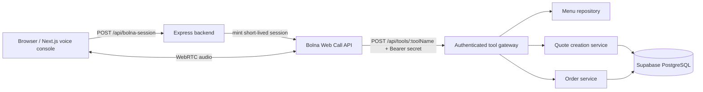

# Call2Kitchen

AI-powered restaurant ordering through real-time voice conversations.

Call2Kitchen lets a customer speak a food order naturally in the browser. A Bolna voice agent collects the request, calls authenticated backend tools for menu data and pricing, receives a server-generated quote, asks for explicit confirmation, and only reports success after the backend persists the order in Supabase.

> **Core principle:** AI handles the conversation. The backend validates the order, calculates the price, and controls persistence.

## Table of contents

- [Overview](#overview)
- [Key features](#key-features)
- [Application workflow](#application-workflow)
- [Architecture and technology stack](#architecture-and-technology-stack)
- [Repository structure](#repository-structure)
- [Prerequisites](#prerequisites)
- [Local installation and setup](#local-installation-and-setup)
- [Environment configuration](#environment-configuration)
- [Database setup](#database-setup)
- [API and tool reference](#api-and-tool-reference)
- [Database and order integrity](#database-and-order-integrity)
- [Testing and verification](#testing-and-verification)
- [Current limitations and production readiness](#current-limitations-and-production-readiness)
- [Contribution guidelines](#contribution-guidelines)
- [License](#license)

## Overview

Restaurant phone ordering is difficult to scale: calls arrive during busy periods, requests can be misunderstood, and totals must be calculated from trusted menu data. Call2Kitchen separates responsibilities:

- **Voice agent:** understands the customer and guides the conversation.
- **Backend:** validates menu items, checks availability, calculates totals, generates quotes, and persists orders.
- **Frontend:** provides a browser-based voice console and a placeholder operations dashboard.
- **Database:** stores restaurants, menu items, quotes, orders, and order line items.

The backend is the source of truth for prices and availability. The voice agent must not invent menu facts, prices, or order outcomes.

## Key features

- Real-time browser voice interaction using the Bolna Web Call SDK.
- Natural-language restaurant ordering.
- Live menu retrieval from Supabase.
- Server-authoritative pricing and quotes.
- Explicit customer confirmation before order placement.
- Supabase persistence of orders and order line items.
- Authenticated tool gateway for voice-agent calls.
- Strict Zod validation for requests and environment variables.
- Quote expiration and confirmation-token validation.
- Idempotency and duplicate-submission protection.
- Honest failure reporting when order placement fails.
- Automated backend, TypeScript, and frontend checks.

Features are implemented in code. Real-integration evidence is summarized in [Testing and verification](#testing-and-verification).

## Application workflow

1. The customer opens the frontend voice console.
2. The browser requests a short-lived Bolna session from `POST /api/bolna-session`.
3. The browser connects to Bolna over WebRTC and streams microphone audio.
4. The customer speaks an order.
5. Bolna calls backend tools over the authenticated gateway.
6. `get_menu` or `get_item_details` returns available items, prices, categories, and allergens.
7. `quote_order` validates requested item IDs and quantities, checks availability, calculates the total, and creates a single-use quote.
8. The agent reads the order and total, then asks for explicit confirmation.
9. After confirmation, `place_order` submits the quote ID, confirmation token, idempotency key, and items.
10. The backend validates the quote and confirmation token, rechecks menu availability and prices, and atomically persists the order.
11. The agent reports success only when `place_order` returns `success: true` with persisted order data.



## Architecture and technology stack

| Component | Technology | Purpose |
| --- | --- | --- |
| Backend runtime | Node.js (>= 20) | Server execution |
| Backend language | TypeScript | Type-safe backend code |
| Web framework | Express 5 | HTTP API and middleware |
| Validation | Zod | Request, route, and environment validation |
| Database | Supabase PostgreSQL | Persistent application data |
| Database client | Supabase JavaScript SDK | Backend database access |
| Voice SDK | `@bolna/web-call` | Browser voice session and WebRTC |
| Voice agent | Bolna | Conversational phone/web ordering |
| Frontend | Next.js 16, React 19, TypeScript | Browser voice console and dashboard shell |
| Styling | Tailwind CSS, Framer Motion | UI styling and motion |
| Testing | Vitest, Supertest | Automated tests |

The backend and frontend are separate applications. The backend listens on port `3000` by default. The frontend listens on port `3001` by default and calls the backend through `NEXT_PUBLIC_API_URL`.

## Repository structure

```text
project-call2kitchen-phase-1-backend-foundation/
├── docs/
│   ├── bolna-agent-setup.md
│   ├── phase-8-staging-verification.md
│   └── supabase-staging-verification.md
├── frontend/
│   ├── app/
│   │   ├── page.tsx
│   │   └── dashboard/page.tsx
│   ├── components/
│   │   ├── dashboard/
│   │   └── voice/
│   ├── lib/api.ts
│   └── package.json
├── src/
│   ├── app.ts
│   ├── server.ts
│   ├── lib/
│   ├── menu/
│   ├── middleware/
│   ├── orders/
│   ├── routes/
│   └── tools/
├── supabase/
│   ├── migrations/
│   └── seed.sql
├── tests/
├── package.json
├── tsconfig.json
└── README.md
```

Important files:

- `src/server.ts` — starts the Express server.
- `src/app.ts` — wires routes and middleware.
- `src/routes/bolna.routes.ts` — mints short-lived Bolna browser sessions.
- `src/routes/tools.routes.ts` — authenticated voice-agent tool gateway.
- `src/tools/tool-gateway.service.ts` — tool dispatch, validation, and compact item adapter.
- `src/orders/quote-creation.service.ts` — quote creation and confirmation token generation.
- `src/orders/order.service.ts` — order validation and request hashing.
- `src/orders/order.repository.ts` — Supabase RPC persistence.
- `frontend/components/voice/voice-console.tsx` — Bolna Web Call lifecycle and UI state.
- `docs/bolna-agent-setup.md` — detailed Bolna dashboard and tool setup.

## Prerequisites

- Node.js >= 20
- npm
- Git
- A Supabase project
- Bolna account and agent configuration for voice features
- A browser with microphone access for the voice console

## Local installation and setup

### 1. Clone and install

```bash
git clone https://github.com/Shreyans-704/Call2Kitchen.git
cd Call2Kitchen
npm install
cd frontend
npm install
cd ..
```

### 2. Configure environment variables

Create a root `.env` file using the variables in [Environment configuration](#environment-configuration). Never commit this file.

### 3. Configure Supabase

Apply the migrations in order, then seed demo data. See [Database setup](#database-setup).

### 4. Configure Bolna

Follow `docs/bolna-agent-setup.md` to configure the agent, system prompt, tools, headers, and HTTPS gateway URL. Bolna dashboard configuration cannot be completed from the repository alone.

### 5. Start the backend

```bash
npm run dev
```

The backend listens on `http://localhost:3000` by default.

### 6. Start the frontend

In a second terminal:

```bash
cd frontend
npm run dev
```

The frontend listens on `http://localhost:3001` by default.

### 7. Verify

```text
http://localhost:3000/api/health
http://localhost:3000/api/menu
http://localhost:3001
```

## Environment configuration

### Backend environment variables

| Variable | Required | Purpose |
| --- | --- | --- |
| `NODE_ENV` | No | Application environment. Defaults to `development`. |
| `PORT` | No | Backend listening port. Defaults to `3000`. |
| `SUPABASE_URL` | Yes, for database features | Supabase project URL. |
| `SUPABASE_SERVICE_ROLE_KEY` | Yes, for database features | Server-side Supabase service-role key. Must never be exposed to the browser. |
| `TOOL_GATEWAY_ENABLED` | No | Enables the authenticated tool gateway. Defaults to `false`. Set to `true` for voice-agent tool calls. |
| `BOLNA_TOOL_GATEWAY_SECRET` | Yes, when gateway is enabled | Shared secret used to authenticate gateway requests. Minimum 32 characters. |
| `BOLNA_API_KEY` | Yes, for browser voice sessions | Server-only Bolna API key used to mint sessions. |
| `BOLNA_AGENT_ID` | Yes, for browser voice sessions | Server-only Bolna agent ID used to mint sessions. |
| `CORS_ALLOWED_ORIGINS` | No | Comma-separated allowed frontend origins. Defaults to `http://localhost:3001`. |

### Frontend environment variables

| Variable | Required | Purpose |
| --- | --- | --- |
| `NEXT_PUBLIC_API_URL` | No | Backend base URL. Defaults to `http://localhost:3000`. |

### Example backend `.env`

```dotenv
NODE_ENV=development
PORT=3000

SUPABASE_URL=https://your-project.supabase.co
SUPABASE_SERVICE_ROLE_KEY=your-server-side-service-role-key

TOOL_GATEWAY_ENABLED=true
BOLNA_TOOL_GATEWAY_SECRET=replace-with-a-long-random-secret

BOLNA_API_KEY=your-server-side-bolna-api-key
BOLNA_AGENT_ID=your-bolna-agent-id

CORS_ALLOWED_ORIGINS=http://localhost:3001
```

### Server-side boundary

The following values must remain server-side and must not be placed in frontend bundles, browser code, URLs, query strings, or logs:

- `SUPABASE_SERVICE_ROLE_KEY`
- `BOLNA_TOOL_GATEWAY_SECRET`
- `BOLNA_API_KEY`
- `BOLNA_AGENT_ID`
- quote confirmation tokens

`BOLNA_TOOL_GATEWAY_SECRET` is a shared secret for the tool gateway. It is different from a Bolna management API key and cannot manage Bolna resources. Rotate it by generating a new value and updating both backend and Bolna configuration together.

When `TOOL_GATEWAY_ENABLED=true`, the backend disables direct `POST /api/orders/quote` and `POST /api/orders` routes. Public `GET /api/menu` remains available.

## Database setup

Apply these migrations in order:

1. `supabase/migrations/20261021180000_create_restaurants_and_menu_items.sql`
2. `supabase/migrations/20261021202000_create_order_confirmation_and_orders.sql`
3. `supabase/migrations/20261021230000_harden_order_rpc_and_rls.sql`

Then run:

```text
supabase/seed.sql
```

The migrations create restaurants, menu items, quotes, orders, order items, and the `create_confirmed_order` RPC. The RPC is `SECURITY DEFINER` and executable by the service role. Row-level security is enabled by the hardening migration.

After setup, verify:

- All expected tables exist.
- Demo restaurant and menu data exist.
- Menu items have expected prices and availability.
- The `create_confirmed_order` RPC exists with expected permissions.
- RLS and grants match the intended security model.

Additional verification guidance is available in:

- `docs/supabase-staging-verification.md`
- `docs/phase-8-staging-verification.md`

## API and tool reference

All successful API responses are wrapped in `data`. Errors use:

```json
{ "error": { "message": "...", "statusCode": 400 } }
```

### Health check

```http
GET /api/health
```

Returns:

```json
{
  "status": "ok",
  "message": "Call2Kitchen backend is running"
}
```

### List menu items

```http
GET /api/menu
```

Returns available menu items, ordered by category and name.

### Get a menu item

```http
GET /api/menu/:id
```

`id` must be a UUID. Returns `400` for invalid IDs and `404` for missing or unavailable items.

### Generate a quote

```http
POST /api/orders/quote
```

Available only when `TOOL_GATEWAY_ENABLED=false`. When gateway mode is enabled, this route returns `404`.

Request:

```json
{
  "items": [
    { "menuItemId": "00000000-0000-4000-8000-000000000101", "quantity": 2 },
    { "menuItemId": "00000000-0000-4000-8000-000000000103", "quantity": 1 }
  ]
}
```

Validation rules:

- 1 to 20 items
- distinct menu item IDs
- integer quantities from 1 to 50
- no extra fields, including price

A successful response includes trusted line totals, `totalAmount`, `currency`, `quoteId`, `confirmationToken`, and `expiresAt`. Quotes expire after five minutes.

### Create a confirmed order

```http
POST /api/orders
```

Available only when `TOOL_GATEWAY_ENABLED=false`. When gateway mode is enabled, this route returns `404`.

Request:

```json
{
  "quoteId": "uuid",
  "confirmationToken": "server-issued-secret-token",
  "idempotencyKey": "stable-key-at-least-16-characters",
  "items": [
    { "menuItemId": "00000000-0000-4000-8000-000000000101", "quantity": 2 }
  ]
}
```

Returns `201` after successful persistence, `200` for a safe replay, and `409` for an idempotency conflict.

### Voice-agent tool gateway

```http
POST /api/tools/:toolName
```

Requires:

```http
Authorization: Bearer <BOLNA_TOOL_GATEWAY_SECRET>
Content-Type: application/json
```

Supported tools:

| Tool | Purpose |
| --- | --- |
| `get_menu` | Retrieve available menu items |
| `get_item_details` | Retrieve details for one menu item |
| `quote_order` | Validate items and generate a quote |
| `place_order` | Create an order using a valid quote and confirmation details |

Gateway responses use:

```json
{ "success": true, "tool": "get_menu", "data": { "items": [] } }
```

Important behavior:

- Unknown tools return `404`.
- Invalid arguments return `400`.
- Missing or invalid authentication returns `401`.
- Tool operations time out after 8 seconds and return `504`.
- HTTP `200` from the gateway is not proof of order success. Check `success: true` and persisted order data.

#### Compact item format

Bolna custom functions support only scalar parameters and interpolate them into JSON without escaping embedded quotes. Nested item arrays can therefore produce malformed JSON before reaching the gateway. The voice transport uses a compact, quote-free format:

```text
menuItemId:quantity,menuItemId:quantity
```

Example:

```text
00000000-0000-4000-8000-000000000103:2,00000000-0000-4000-8000-000000000106:3
```

The gateway adapter converts this compact string, or a legacy JSON string containing an array, into the existing strict quote and order schemas. Direct HTTP routes continue to require arrays.

#### Browser voice session

```http
POST /api/bolna-session
```

Mints a short-lived Bolna WebRTC session. The frontend calls this endpoint; Bolna credentials remain server-side.

Behavior:

- Returns `200` with the Bolna session response on success.
- Returns `503` when Bolna configuration is missing.
- Returns `502` for upstream failure or an invalid session response.
- Returns `504` on upstream timeout.
- Applies an in-memory per-IP rate limit of 10 mint attempts per 60 seconds (`429`).

## Database and order integrity

Supabase PostgreSQL stores:

| Table | Responsibility |
| --- | --- |
| `restaurants` | Restaurant information and operating status |
| `menu_items` | Menu item names, prices, categories, and availability |
| `order_quotes` | Server-generated quotes and confirmation metadata |
| `orders` | Persisted customer orders and order totals |
| `order_items` | Order line items with price and item snapshots |

Order processing:

1. The backend validates requested item IDs and quantities.
2. It checks menu availability and uses database prices.
3. It creates a quote with an expiration time of five minutes.
4. The quote stores a hashed confirmation token.
5. The agent obtains explicit customer confirmation.
6. `place_order` submits the quote ID, confirmation token, idempotency key, and items.
7. The `create_confirmed_order` RPC locks the quote, validates the token and expiration, checks that the quote has not been consumed, revalidates menu data and prices, inserts the order and line items, and marks the quote consumed.
8. A safe retry with the same idempotency key and request hash returns the existing order with `replayed: true`.
9. A reused idempotency key with conflicting request content returns `409`.

Failed order creation does not return success. If the backend cannot persist the order, the voice agent must report that the order could not be completed.

## Testing and verification

Backend commands:

```bash
npm test
npm run build
npx tsc --noEmit
```

Frontend commands:

```bash
cd frontend
npm run type-check
npm run lint
npm run build
```

Targeted tests:

```bash
npx vitest run tests/order.service.test.ts tests/order-rpc.migration.test.ts tests/tool-gateway.service.test.ts
```

The repository currently contains 54 backend tests across 8 test files. Latest automated results from the completed verification run:

- Backend tests: 54/54 passed
- Backend TypeScript check: passed
- Backend build: passed
- Frontend type-check: passed
- Frontend lint: passed
- Frontend build: passed

Reported real-integration evidence from the completed verification run:

- A real Bolna browser session was established.
- Microphone input and agent audio playback were verified in a controlled Chrome run.
- Real backend tool calls were verified.
- A successful order was persisted in Supabase.
- A duplicate submission returned the existing order.
- A controlled HTTP `503` order-placement failure was handled honestly, with no order created for the failed quote.

Automated tests verify service logic and schemas. They do not by themselves prove that every external integration, deployment, or production configuration works end to end.

## Current limitations and production readiness

The application is not production-ready in its current form. Known limitations:

- The Bolna agent uses a temporary ngrok endpoint. A stable HTTPS deployment is required before production use.
- Browser session creation does not currently have browser-user authentication. Treat `POST /api/bolna-session` as an internal/trusted-origin surface.
- No webhook implementation exists yet.
- The operations dashboard is a placeholder and does not display live order data.
- The successful verification order remains in Supabase as test data.
- Supplementary documentation such as `docs/bolna-agent-setup.md` may not reflect the latest verification status.
- A Next.js build warning about multiple lockfiles may appear because both root and frontend lockfiles exist.

Security and operational considerations:

- Keep all server-side secrets out of frontend bundles and logs.
- Use HTTPS for all external API traffic.
- Rotate the gateway secret if it is exposed.
- Verify database policies, grants, RLS, and RPC permissions in the deployed Supabase project.
- Test retries, expired quotes, invalid confirmation tokens, and concurrent requests before production.
- Never report an order as placed unless `place_order` returns success with persisted order data.

## Contribution guidelines

- Use TypeScript and keep changes consistent with the existing structure.
- Validate new inputs with Zod.
- Add or update tests for behavior changes.
- Run backend tests, TypeScript checks, and frontend checks before submitting changes.
- Do not commit secrets, `.env` files, or generated local artifacts.
- Do not claim integration success from compilation or mocked tests alone.

The project is licensed under the MIT License. See `LICENSE`.

## License

MIT License. Copyright (c) 2026 Shreyans Jaiswal.

## Repository

GitHub: https://github.com/Shreyans-704/Call2Kitchen

Built with Node.js, TypeScript, Express, Supabase, Next.js, and Bolna integration.